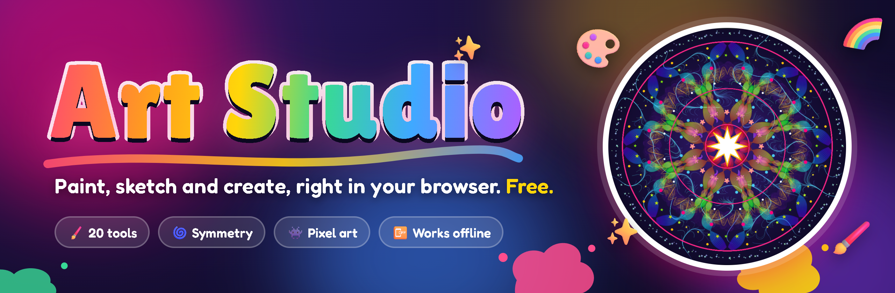
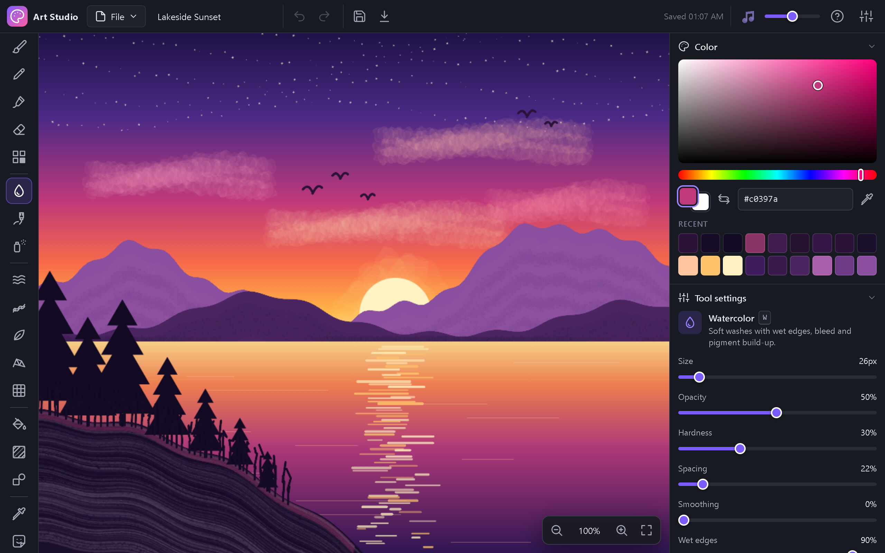
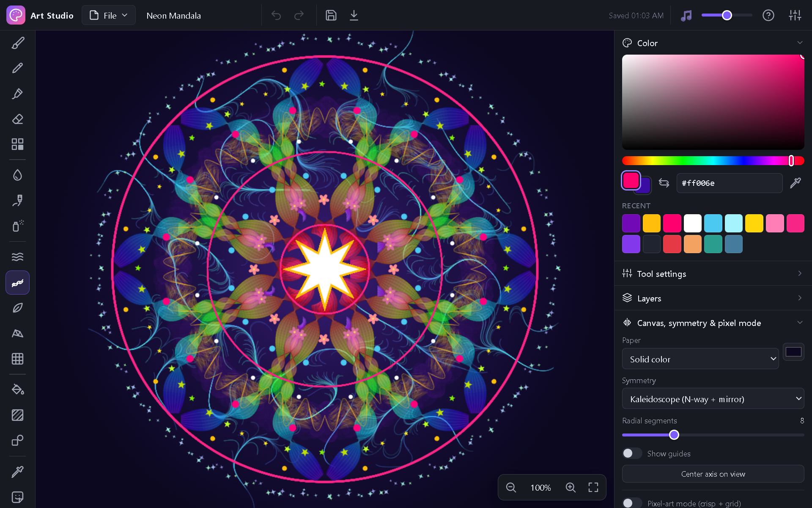
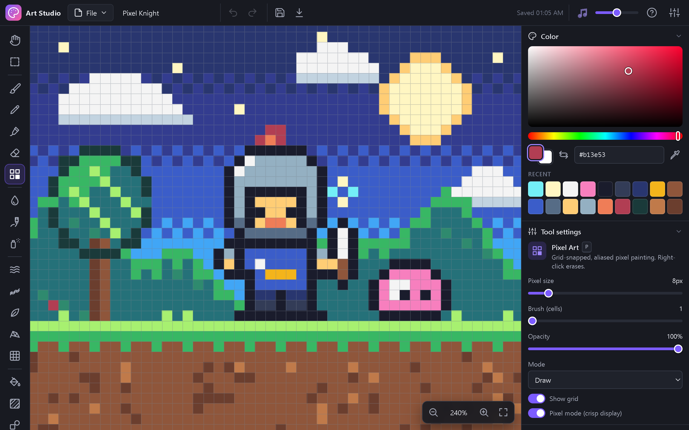
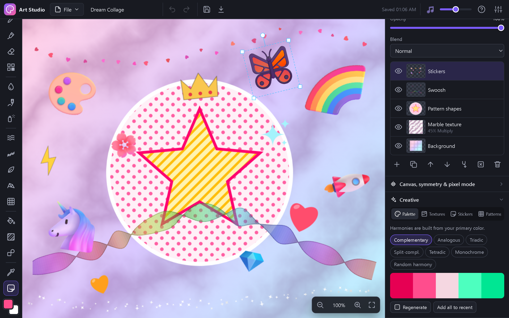
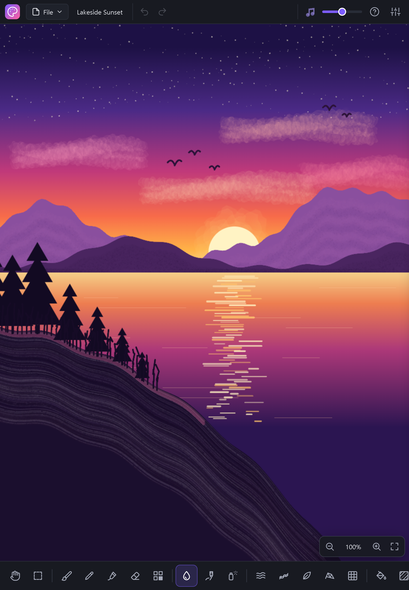

<p align="center">
  <a href="https://jaineil32624.github.io/Art-Studio/"></a>
</p>

<p align="center">
  <a href="https://jaineil32624.github.io/Art-Studio/"></a>
  <a href="https://github.com/jaineil32624/Art-Studio/releases/latest/download/Art-Studio.zip"></a>
  <a href="https://jaineil32624.github.io/Art-Studio/"></a>
</p>

<p align="center">
  
  
  
  
  <a href="LICENSE"></a>
</p>

<h3 align="center">🎨 An infinite canvas, 20 tools, watercolor, oil, pixel art and magic symmetry. Free, right in your browser. ✨</h3>

<table>
  <tr>
    <td width="50%"><p align="center">🌅 <b>Watercolor &amp; oil</b>: wet edges, bristles, real color mixing</p></td>
    <td width="50%"><p align="center">🌀 <b>Kaleidoscope symmetry</b> + generative brushes</p></td>
  </tr>
  <tr>
    <td width="50%"><p align="center">👾 <b>Pixel-art mode</b>: snap-to-grid, crisp pixels</p></td>
    <td width="50%"><p align="center">🦄 <b>Stickers, textures &amp; patterns</b>, plus layers and palettes</p></td>
  </tr>
</table>

<p align="center">
  <br>
  📱 <b>Made for tablets too</b>: pen pressure, pinch to zoom, two-finger pan
</p>

## ✨ What you can do

- ♾️ **Paint anywhere** on an infinite canvas, and pan and zoom as far as you like.
- 🖌️ **Brush, pencil, marker and eraser**, with pen pressure and stroke smoothing.
- 💧 **Watercolor** with soft wet edges, bleed and pigment that builds up.
- 🎨 **Oil paint** with bristle streaks that pick up and smear the colors underneath.
- 🌫️ **Spray paint** that keeps building up while you hold still.
- 🌀 **Symmetry**: mirror, 4-way, radial and kaleidoscope. Mandalas in seconds.
- 🤖 **Generative brushes**: flow fields, twisting rainbow ribbons, scattered leaves, stars and hearts, and sketchy webs. All procedural, no internet needed.
- 👾 **Pixel-art mode** with a grid, crisp pixels and adjustable pixel size.
- 🔷 **Shapes** (line, rectangle, ellipse, polygon, star), a **fill bucket** and a **multi-stop gradient** editor.
- 🦄 **Stickers**: 32 emoji and 12 vector stickers you can move, scale and rotate.
- 🪨 **Texture generator** (marble, wood, clouds, cells, stone) and a **pattern maker**.
- 🌈 **Palette generator** (complementary, analogous, triadic and more), built from your color.
- 🗂️ **Layers** with opacity, 16 blend modes, merge and drag-to-reorder, plus **undo/redo**.
- 🎵 **Optional dreamy background music** to paint to (toggle and volume in the top bar).
- 💾 **Autosaves** in your browser. Export **PNG**, **JPG** or a project file to keep editing later.

## 🚀 Start in 10 seconds

| | How |
|---|---|
| 🌐 **Option 1: Online** | Open **[jaineil32624.github.io/Art-Studio](https://jaineil32624.github.io/Art-Studio/)** and start painting. |
| ⬇️ **Option 2: Download** | Get **[Art-Studio.zip](https://github.com/jaineil32624/Art-Studio/releases/latest/download/Art-Studio.zip)**, unzip it and double-click `index.html`. It works offline and there's nothing to install. |
| 📱 **Option 3: Phone / tablet** | Open the [link](https://jaineil32624.github.io/Art-Studio/), then tap **Share → Add to Home Screen** (iPhone/iPad) or **⋮ → Add to Home screen** (Android). |

> 💡 Your artwork autosaves in the browser. Use **File → Export project** to back it up or move it to another device.

## ⌨️ Shortcuts

| Key | Tool | | Key | Action |
|:---:|---|---|:---:|---|
| `B` | 🖌️ Brush | | `Ctrl` `Z` | ↩️ Undo |
| `N` | ✏️ Pencil | | `Ctrl` `Y` | ↪️ Redo |
| `M` | 🖍️ Marker | | `Ctrl` `S` | 💾 Save in browser |
| `E` | 🧽 Eraser | | `Ctrl` `E` | 🖼️ Export PNG |
| `W` | 💧 Watercolor | | `Ctrl` `O` | 📂 Open project |
| `O` | 🎨 Oil paint | | `Space` + drag | ✋ Pan |
| `A` | 🌫️ Spray paint | | Wheel / pinch | 🔍 Zoom |
| `P` | 👾 Pixel art | | `[` `]` | ↔️ Brush size |
| `F` | 🌊 Flow field | | `Shift` `[` `]` | 🌗 Opacity |
| `Y` | 🎀 Ribbon | | `X` | 🔁 Swap colors |
| `C` | 🍃 Scatter shapes | | `Alt` + click | 💉 Pick a color |
| `K` | 🕸️ Sketchy web | | `Ctrl` `J` | 📄 Duplicate layer |
| `Q` | 🧩 Pattern brush | | `Ctrl` `M` | ⬇️ Merge down |
| `G` | 🪣 Fill bucket | | `0` / `1` | 🎯 Fit / 100% |
| `D` | 🌈 Gradient | | `Enter` / `Esc` | ✅ Apply / ❌ cancel sticker |
| `U` | 🔷 Shapes | | `Delete` | 🗑️ Clear selection |
| `I` | 💉 Eyedropper | | `Tab` | 🧰 Show/hide panels |
| `S` | 🦄 Stickers | | `?` | ❓ Help |
| `R` | ⬚ Select | | 🎵 button | 🔊 Music on/off |
| `H` | ✋ Hand | | | |

<details>
<summary><b>🛠️ For developers: architecture, brush engine, adding a brush</b></summary>

<br>

Art Studio is plain HTML, CSS and JavaScript, with no libraries, no build step and no network access. It runs straight from disk (`file://`). In the code, everything lives under the `window.App2` namespace.

### 📚 Full feature reference

#### Core
- **Infinite canvas.** Each layer is stored as a sparse grid of 256×256 tiles, so you can draw anywhere.
- **Pan and zoom.**
  - Pan: Space+drag, the middle mouse button, a two-finger drag, or the Hand tool.
  - Zoom: the mouse wheel (zooms at the cursor), a pinch gesture, the `+`/`−` keys, or the zoom buttons. *Fit* and *100%* are also available.
- **Brush.** Soft round brush with hardness. Pressure controls size, and optionally opacity.
- **Pencil.** Hard, aliased pixels drawn along Bresenham lines, so 1 px lines stay crisp.
- **Marker.** Flat and semi-transparent. Paint doesn't build up within a single stroke (round or chisel tip).
- **Eraser.** Erases to transparency, applied as a single pass.
- **Color picker.**
  - HSV square plus a hue strip, and a hex input.
  - Primary and secondary colors with a swap button (`X`).
  - Eyedropper tool, also available by holding Alt with any painting tool.
  - Recent colors.
- **Layers.**
  - Add, delete, duplicate, rename (double-click), clear and merge down.
  - Reorder by drag-and-drop or with the up/down buttons.
  - Visibility, opacity and 16 blend modes.
  - Live thumbnails.
- **Undo/redo.** Ctrl+Z, Ctrl+Y or Ctrl+Shift+Z, plus buttons. Each undo step stores per-tile snapshot diffs cropped to the changed area. Total history is capped at 100 steps or about 192 MB, whichever comes first.

#### Art tools
- **Watercolor.** Soft blobs shaped by noise, with darker wet edges, bleed, granulation and pigment that builds up.
- **Oil paint.** Bristle streaks with different shades. The brush picks up color from the canvas and smears it, then slowly reloads its own color.
- **Pixel art mode.**
  - Paints on an adjustable grid size, with no anti-aliasing. Right-click erases.
  - Nearest-neighbour display and a grid overlay.
- **Spray paint.** Works like an airbrush: paint keeps building up while you hold the pointer still.
- **Shapes.**
  - Line, rectangle (with rounded corners), ellipse, polygon and star.
  - Stroke, fill, or both, with a live preview. Shift constrains the shape and Alt draws from the center.
- **Fill bucket.** Scanline flood fill with a tolerance setting. Fills with color or with a pattern, and has options to sample all layers and to grow the fill by 1 px.
- **Gradient.**
  - Linear or radial, with a multi-stop editor (add, drag, recolor, delete and reverse stops) and presets.
  - Option to clip the gradient to existing layer content.
- **Symmetry.** Vertical, horizontal, both axes, radial N-way, and kaleidoscope (N-way plus mirror). Works with all brushes, the pixel tool and shapes.

#### Creative
- **Procedural "AI-inspired" brushes.** These are entirely procedural and never touch the network.
  - **Flow Field:** particles follow a Perlin-noise vector field.
  - **Generative Ribbon:** a twisting ribbon that cycles through hues.
  - **Scatter Shapes:** procedural leaves, stars, flowers, hearts, sparkles and confetti.
  - **Sketchy Web:** connects nearby points with hairlines.
- **Texture generator.**
  - Clouds, marble, wood grain, cells, stone and static. All of them tile seamlessly.
  - Set the seed, scale, detail, two colors and the size.
  - Place the texture on a new layer, or save it as a pattern.
- **Stickers.**
  - 12 vector stickers, which can be tinted with the primary color, and 32 emoji.
  - After placing a sticker you can move, scale and rotate it (Shift snaps the angle), flip it and set its opacity before committing.
  - The same placement tool is used for imported images and textures.
- **Patterns.**
  - Generators: checker, stripes, dots, grid, zigzag, bricks and hearts.
  - You can also create a pattern from a selection or from a texture.
  - Use patterns with the fill bucket, the Pattern Brush or shape fills. Patterns are anchored to world coordinates, so separate strokes line up.
- **Palette generator.** Complementary, analogous, triadic, split-complementary, tetradic, monochrome and random harmony. Click a swatch to use it as the primary color, or right-click for the secondary.

#### Saving
- **Autosave.** Saves to `localStorage` a few seconds after each change. The previous session is restored when you reopen the app.
- **Manual save.** Ctrl+S saves to the browser. *File → Restore last browser save* brings it back.
- **Export PNG.** Transparent, or with the paper color. The image is cropped to the artwork.
- **Export JPG.** Flattened onto a white background.
- **Project files.** Export and import `.app2.json` files, which hold the layers as PNG data URLs (one per tile) plus metadata. You can also drop a project file or an image onto the canvas.

#### UX
- **Background music (optional).** Dreamy procedural pads and soft bells generated live with the Web Audio API (no audio files). Toggle 🎵/🔇 and set the volume in the top bar; your choice is remembered. Browsers only allow sound after your first click or key press.
- **Interface.**
  - Dark UI with a tool bar on the left (icons and tooltips that show shortcuts), a top bar for file actions and history, and a right panel with collapsible sections: Color, Tool settings, Layers, Canvas, and Creative.
  - The sliders in the right panel show values as you drag, and each tool remembers its own settings.
- **Input.** Pointer Events with pen pressure and coalesced events for smooth strokes. Adjustable stroke smoothing.
- **Responsive.** On tablets and phones the tool bar moves to the bottom and the side panel becomes a slide-over drawer. Touch targets are larger and two-finger gestures pan and zoom.

### 🏗️ Architecture

```
Art-Studio/
├── index.html            ← loads every script in dependency order (classic <script> tags)
├── css/app.css           ← dark theme + responsive layout
└── js/
    ├── core/             ← namespace, EventBus, math (rects, matrices), color, noise (Perlin/fBm/Worley), Store (app state)
    ├── canvas/           ← TiledLayer, ArtDocument, Viewport, History, Commands (undoable layer ops), Symmetry, Renderer
    ├── tools/
    │   ├── tool.js       ← Tool base class + ToolManager + App2.tools.register()
    │   ├── brush-tool.js ← generic driver: smoothing, spacing, pressure, symmetry lanes, stroke buffers, history
    │   ├── brushes/      ← brush-engine registry + one file per engine
    │   └── *-tool.js     ← hand, select, pixel, fill, gradient, shape, eyedropper, sticker/place
    ├── creative/         ← textures, stickers, patterns, palettes
    ├── io/               ← project (de)serialisation, localStorage, export/import
    ├── ui/               ← icons, DOM helpers, top bar, tool bar, panels, canvas input, shortcuts
    └── main.js           ← boot: builds App2.app and wires everything together
```

Key ideas:

- **Namespace instead of modules.** Every file is an IIFE that attaches to `window.App2`. This avoids `import`, which is blocked under `file://`. `index.html` lists the scripts in dependency order.
- **Tiles and `paint()`.** All pixel writes go through `layer.paint(worldRect, fn)`. The callback runs once for each 256 px tile in the rectangle, with the context already translated into world coordinates. Tiles are created on demand, and an attached history recorder snapshots each tile before it changes.
- **History.** `history.begin(layer)` → paint → `history.end(label)`. Each entry stores only the dirty rectangle of each touched tile, as before and after `ImageData`. Tiles that end up empty are deleted. Layer and structure operations are stored as small `undo()`/`redo()` closures (see `canvas/actions.js`).
- **Stroke buffers.** Buffered brushes (Brush, Pencil, Marker, Eraser, Pattern) paint into a temporary layer. The renderer previews it composited onto the target layer, and it's committed once at the stroke's opacity using the brush's composite mode (`destination-out` for the eraser). This is why opacity never builds up within a stroke.
- **Symmetry.** Each mode produces a list of affine matrices. Brushes run one stroke "lane" per matrix, and shapes apply each matrix with `ctx.transform`.
- **Events.** Modules talk to each other through `app.bus` (`doc:changed`, `layers:changed`, `tool:changed`, `color:changed`, …). The renderer batches drawing with `requestAnimationFrame`.

### 🖌️ How to add a brush

1. Create `js/tools/brushes/my-brush.js`:

```js
(function (App2) {
  'use strict';
  const { Color } = App2.core;

  App2.brushes.register({
    id: 'confetti-line',        // unique; also the tool id
    name: 'Confetti Line',      // tooltip + panel title
    icon: 'sparkles',           // any key from js/ui/icons.js
    shortcut: 'j',              // optional single key
    group: 'gen',               // paint | art | gen  (tool bar grouping)
    order: 260,                 // position in the tool bar
    description: 'Little squares along the stroke.',
    buffered: false,            // true = paint into a stroke buffer (no build-up)
    defaults: { size: 30, opacity: 1, spacing: 0.4, jitter: 0.5 },
    options: [                  // extra controls, rendered automatically
      { key: 'jitter', label: 'Jitter', type: 'range', min: 0, max: 1, step: 0.01, format: 'pct' },
    ],

    // Called for each evenly spaced dab. p = {x, y, pressure, angle, radius, alpha, dist}
    dab(s, p) {
      // IMPORTANT: compute all randomness BEFORE painting. paint() calls the
      // callback once per touched tile, so random values generated inside it
      // would differ between tiles and leave visible seams.
      const ox = (s.rng() - 0.5) * p.radius * s.settings.jitter * 2;
      const oy = (s.rng() - 0.5) * p.radius * s.settings.jitter * 2;
      const color = Color.rgba(Color.hueShiftRgb(s.rgb, s.rng() * 60), 1);
      s.paintAt(p.x + ox, p.y + oy, p.radius, (ctx) => {
        ctx.globalAlpha = p.alpha;
        ctx.fillStyle = color;
        ctx.fillRect(p.x + ox - p.radius / 2, p.y + oy - p.radius / 2, p.radius, p.radius);
      });
    },
  });
})(window.App2);
```

2. Add `<script src="js/tools/brushes/my-brush.js"></script>` to `index.html`, after `brush-tool.js` and before `main.js`.

That's all. The engine appears in the tool bar with a tooltip and shortcut, gets a settings panel (size, opacity, hardness, spacing, smoothing, pressure toggles and your options) and works with symmetry, undo/redo, Alt-to-pick and saving.

Other hooks you can use:
- `begin(s)` / `end(s)`: run at the start and end of a stroke. Keep per-stroke state in `s.state`.
- `segment(s, a, b)`: replaces `dab` for continuous drawing (see `pencil.js`).
- `airbrush: true`: keeps emitting dabs while the pointer is held still.
- `composite: 'destination-out'`: how a buffered stroke is committed.
- `s.sample(x, y, r)`: average color under the brush, used for smudging.

Custom non-brush tools subclass `App2.tools.Tool` and call `App2.tools.register({ id, name, icon, shortcut, group, order, defaults, create: (app, def) => new MyTool(app, def) })`.

### ⚠️ Known limitations

- **Open-area fills.** Because the canvas is infinite, the fill bucket and the gradient are limited to the visible area plus the existing content. That region is capped at 4096 px per side for fills and 8192 px for gradients. Filling an open area fills up to that boundary.
- **Selection.** The rectangle selection is used for patterns, copying to a new layer and clearing. It doesn't clip other painting tools.
- **Browser storage.** `localStorage` is limited, so very large documents need **Export project**.
- **Emoji.** Emoji stickers use the system's emoji font, so they look different on each OS.
- **Pressure.** Pressure is read only from pens. Mouse and touch input are treated as full pressure.

</details>

---

<h3 align="center">Like it? ⭐ Star the repo!</h3>

<p align="center">
  <a href="https://jaineil32624.github.io/Art-Studio/"></a>
  <a href="https://github.com/jaineil32624/Art-Studio/releases/latest/download/Art-Studio.zip"></a>
  <a href="https://jaineil32624.github.io/Art-Studio/"></a>
</p>

<p align="center">
  <a href="https://github.com/jaineil32624/Art-Studio"></a>
</p>

## License

MIT © 2026 Jaineil Rana. See [LICENSE](LICENSE).
